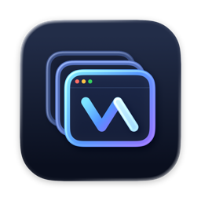
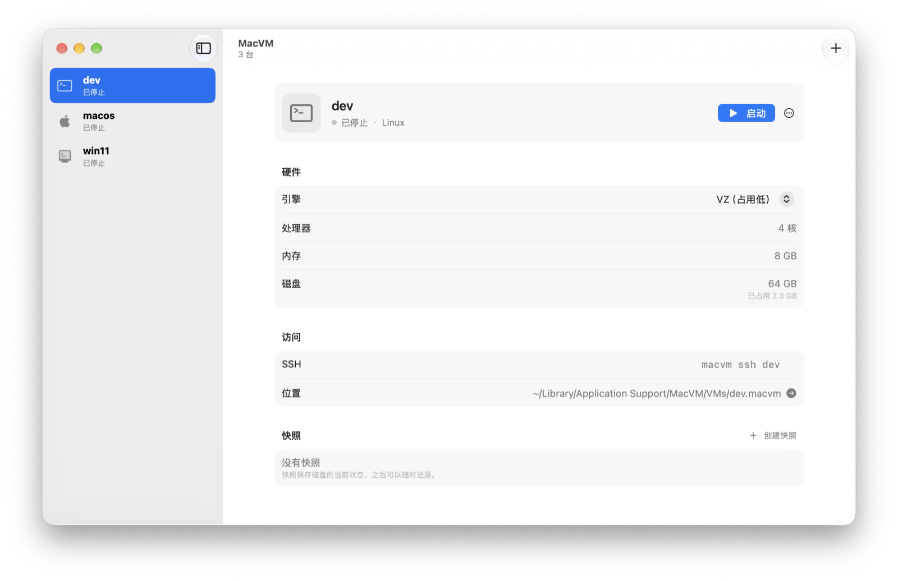

<p align="center">
  
</p>

<h1 align="center">MacVM</h1>

<p align="center">
  在 Apple Silicon Mac 上运行 macOS、Linux 和 Windows 虚拟机。<br>
  原生 App 与 <code>macvm</code> 命令行共用一套引擎，几分钟装好一台能用的系统。
</p>

<p align="center">
  <a href="https://github.com/macvm-dev/macvm/actions/workflows/ci.yml"></a>
  
  
  <a href="LICENSE"></a>
</p>

<p align="center">
  
</p>

---

## 特性

- **三种系统，一个入口**：macOS、Linux、Windows（ARM64）都能在 App 里点几下建好，也能用一条命令建好。
- **无人值守安装**：macOS 自动下载最新 IPSW 并装好；Windows 用微软原版 ISO 自动部署，可填产品密钥自动激活；Linux 云镜像几秒开机，用户、SSH 密钥和代理都已配好。
- **原生性能**：基于 Apple Virtualization.framework，占用低、启动快。Windows 需要声音或 3D 加速时，可以切换到 App 自带的 QEMU 引擎。
- **好用的 Windows**：Direct3D 11 硬件加速，分辨率跟随窗口大小，支持 Retina，光标直接用 macOS 的，跟手没有延迟。
- **开发者友好**：`macvm exec` 直接在客户机里执行命令，配好 `macvm ssh-config` 后 `ssh 虚拟机名` 即可登录；支持共享目录，Linux 下可用 Rosetta 运行 x86_64 程序；所有命令都能输出 JSON，方便写脚本。
- **剪贴板互通**：宿主和虚拟机之间直接复制粘贴文本。macOS 和 Windows 客户机经客户机代理同步，还能复制粘贴文件；Linux 客户机经 spice-vdagent 同步文本。
- **拖放文件**：把宿主的文件或文件夹拖进虚拟机窗口，复制到放下处的访达或资源管理器窗口（不在文件夹窗口上时放到桌面）；在 macOS、Windows 客户机里把文件拖出窗口，放到访达里即复制出来。命令行用 `macvm cp`。
- **快照与克隆**：随时存一个快照、一键还原，或者把整台虚拟机克隆一份。
- **菜单栏常驻**：不开主窗口也能看到虚拟机状态和创建进度。

## 系统要求

- 搭载 Apple Silicon（M 系列芯片）的 Mac
- macOS 15 或更新版本
- 部署 Windows 需要 QEMU：macOS 27 起 App 自带；更早的系统请先 `brew install qemu`

## 安装

1. 从 [Releases](https://github.com/macvm-dev/macvm/releases/latest) 下载最新的 `MacVM-<版本>.dmg`。
2. 打开 DMG，把 `MacVM.app` 拖到「应用程序」。App 已经过 Apple 公证，可以直接打开。
3. 打开 App 时会自动把命令行工具 `macvm` 链接到 `~/.local/bin/macvm`。这个目录不在 PATH 里的话，把它加进 shell 配置，或者改链到 `/usr/local/bin`：

   ```sh
   sudo mkdir -p /usr/local/bin && sudo ln -sf /Applications/MacVM.app/Contents/Resources/bin/macvm /usr/local/bin/macvm
   ```

4. 想让 Claude Code、Codex 等 agent 帮你操作虚拟机，选菜单「MacVM › 安装 Agent 技能…」：App 打开终端运行 `npx skills add`（需要 Node.js），在里面选要装给哪些 agent，之后每次打开 App 会自动更新已装的技能。

有新版时 App 会提示更新（用 [Sparkle](https://sparkle-project.org)），也可以随时选「MacVM › 检查更新…」，或在「设置 › 通用」里关掉自动检查。

想自己编译，见[从源码构建](#从源码构建)。

## 快速上手

### 用 App

1. 打开 MacVM，点工具栏的 **+**（或按 ⌘N）。
2. 选择系统：macOS、Linux（服务器云镜像或桌面版）、Windows。
3. 创建在后台进行，可以随时取消；完成后点 **启动**，虚拟机窗口会自动打开。

在侧栏双击虚拟机可以直接启动，右键可以关机或在 Finder 中显示。详情页里能复制 SSH 命令、创建和还原快照。

### 用命令行

**Linux**：从云镜像创建，几秒开机。

```sh
macvm create dev --image debian-13
macvm exec dev -- uname -a        # 虚拟机没运行时会自动在后台启动
macvm ssh dev
```

**macOS**：下载最新 IPSW，无人值守安装并开通 SSH。

```sh
macvm create mac --os macos
```

**Windows**：先从[微软官网](https://www.microsoft.com/software-download/windows11arm64)下载 Windows 11 ARM64 ISO。

```sh
macvm create win --os windows --iso Win11_arm64.iso
macvm set win --engine vz         # 装好后日常可改用 VZ 引擎，占用更低
```

**日常操作**

```sh
macvm ls                          # 列出所有虚拟机
macvm suspend dev                 # 挂起，之后 macvm start dev 恢复
macvm snapshot save dev clean     # 存快照，之后 macvm snapshot restore dev clean 还原
macvm clone dev dev2
macvm ssh-config --install        # 之后直接 ssh dev
```

完整的命令、选项、JSON 输出格式和退出码见 [docs/cli.md](docs/cli.md)。

## 支持的客户机

| 系统 | 安装方式 | 引擎 |
| --- | --- | --- |
| macOS | 自动下载最新 IPSW，或用 `--ipsw` 指定本地文件 | VZ |
| Linux 服务器 | Debian 13、Ubuntu 24.04 云镜像（`--image`） | VZ / QEMU |
| Linux 桌面 | Ubuntu Desktop、Fedora Workstation 官方安装 ISO（`--desktop`），在窗口里图形安装 | VZ / QEMU |
| Windows 11 | 微软原版 ARM64 ISO 无人值守部署，装好后自带 OpenSSH | 部署用 QEMU，之后 VZ / QEMU 任选 |

只支持 ARM64 客户机，不支持 x86 版的 Windows 和 Linux；Linux 里的 x86_64 程序可以借助 Rosetta 运行。

## 两种引擎

|  | VZ（默认） | QEMU |
| --- | --- | --- |
| 资源占用 | 最低 | 多一个 QEMU 进程 |
| macOS 客户机 | ✓ | — |
| 共享目录 | ✓ | — |
| Windows 声音 | — | ✓ |
| Windows、Linux 挂起 | macOS 与无画面的 Linux 可以 | 只有 Homebrew 的 QEMU（自带的 QEMU 用 virgl 3D，不能挂起） |
| Windows 3D 加速、分辨率跟随窗口 | — | ✓（App 自带的 QEMU） |
| Linux 客户机不用的内存还给 macOS | — | ✓（App 自带的 QEMU） |

虚拟机停止时，可以用 `macvm set <名称> --engine vz|qemu` 或在 App 详情页里切换。注意 Windows 装上 3D 显卡驱动后只能继续用 QEMU 运行。

## 网络连接方式

客户机在 Mac 内置的 NAT 网络里，能上网，Mac 能访问客户机，局域网里的其他设备访问不到。要从 Mac 的 localhost 或局域网访问客户机里的服务，用端口转发：在虚拟机详情页的「端口转发」里添加，或者用命令行：

```sh
macvm set dev --add-forward 8080:80          # 虚拟机运行期间，localhost:8080 接到客户机的 80 端口
macvm set dev --add-forward 0.0.0.0:2222:22  # 局域网里的其他设备也能连
macvm set dev --remove-forward 8080
macvm forward dev 3000:3000                  # 临时转发，按 Ctrl-C 结束，不改配置
```

运行中增删立即生效。只转发 TCP。更多细节见 [docs/cli.md](docs/cli.md) 的「端口转发」一节。

## 数据存放位置

| 内容 | 默认位置 |
| --- | --- |
| 虚拟机 | `~/Library/Application Support/MacVM/VMs` |
| 下载缓存（IPSW、镜像、ISO） | `~/Library/Caches/MacVM` |

两个位置都可以在 App 的「设置」里更改，命令行读取同一份设置。虚拟机磁盘是稀疏文件，只按实际写入的数据占用空间。

## 常见问题

**支持 Intel Mac 吗？**
不支持。MacVM 运行的都是 ARM64 客户机，只能在 Apple Silicon 上使用。

**Windows 需要激活吗？**
不填产品密钥也能安装和使用，只是处于未激活状态。创建时用 `--product-key`（或在 App 里填写），首次登录后会自动联网激活。

**Windows 为什么要用 QEMU 部署？**
MacVM 的无人值守部署流程是在 QEMU 下完成的。装好之后可以换成 VZ 引擎日常使用，资源占用更低。

**为什么 VZ 下虚拟机占用的内存只涨不降？**
这是 Virtualization.framework 的限制：客户机用过的内存，即使之后释放了，在虚拟机关机前也不会还给 macOS，它的内存气球同样收不回来。想让占用跟着客户机的实际用量走，可以把 Linux 虚拟机切到 QEMU 引擎（需要 App 自带的 QEMU）：客户机释放的内存几秒内就还给 macOS；装了客户机代理时，还会每分钟修剪多余的页缓存。较早创建的虚拟机要先用 `macvm agent install <名称>` 更新代理。用 VZ 时，给虚拟机分配够用的内存即可，不要分得过多。

**能同时运行几台 macOS 虚拟机？**
受 macOS 许可协议和 Virtualization.framework 的限制，同一时间最多运行两台 macOS 客户机；Linux 和 Windows 没有这个限制。

## 从源码构建

需要 Xcode 27 和 Rust（通过 [rustup](https://rustup.rs) 安装）。

```sh
make sign            # 调试构建并签名：.build/debug/macvm、.build/debug/MacVMApp
make agent           # 交叉编译客户机代理（Windows 版需 cargo install cargo-xwin）
make boot            # 编译 UEFI 引导程序
make qemu            # 编译 App 自带的 QEMU（可选，首次较久）
make run             # 编译客户机代理与引导程序，调试构建，组装 .build/MacVM.app 并在前台运行（有 Developer ID 证书时用它签名）
make app             # 发布构建并组装 dist/MacVM.app
make test lint       # 运行测试与检查
```

请始终通过 `make` 构建，它会带上让 App 使用新版系统外观所需的参数。发布签名用 `make app SIGN_IDENTITY="Developer ID Application: …"`，公证用 `make release`。

参与开发前请先阅读 [AGENTS.md](AGENTS.md)，里面有目录结构、分层规则和代码约定。宿主与客户机代理之间的协议见 [docs/agent-protocol.md](docs/agent-protocol.md)。

## 许可证

MacVM 以 [MIT 许可证](LICENSE) 发布。App 自带的 QEMU 及其图形组件、Windows 驱动等第三方组件沿用各自的许可证（QEMU 为 GPL 2.0），随 App 一起分发在 QEMU 目录的 `licenses/` 中。
